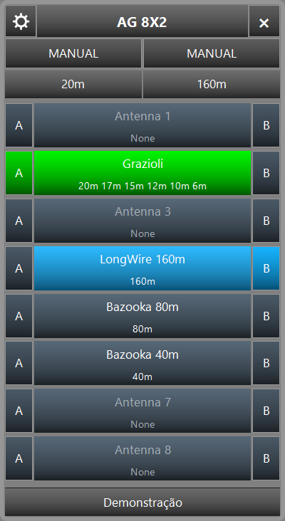

# AG 4O3A

Controlo do Antenna Genius v4, com ligação local ou remota e integração FlexRadio.

**Desenvolvido por Eduardo Arraia — CT7ASY.**

Software de distribuição gratuita para Windows.

**[Descarregar a versão mais recente para Windows](https://github.com/CT7ASY/Antena-Genius-4O3A/releases/latest)**



## Funcionalidades

- Seleção e desligamento de antenas nas portas A e B.
- Transferência de antenas entre portas, com verificações de transmissão.
- Integração FlexRadio, descoberta de rádios e acompanhamento de banda.
- Ligação local ou remota e configuração de DHCP, IP, máscara e gateway.
- Configuração de antenas e bandas, com diagramas BCD e P2P.
- Interface em português, espanhol e inglês.
- Janela redimensionável, fontes proporcionais e posições memorizadas.
- Instância única e importação/exportação das definições suportadas.
- Acesso às novas versões em **Sobre → Verificar atualizações**.

## Transferir e instalar

Na [versão mais recente](https://github.com/CT7ASY/Antena-Genius-4O3A/releases/latest), transfira o instalador ou o ZIP portátil. Requer Windows 10/11 e .NET Framework 4.8.

- **Instalador:** execute `Instalar-AG-4O3A-1.0.0.exe`. A pasta de instalação é `C:\CT7ASY\AG 4O3A`.
- **Portátil:** extraia todos os ficheiros do ZIP para uma pasta e execute `AG4O3A.exe`.
- Abra a engrenagem e configure o endereço do seu equipamento. O endereço inicial `127.0.0.1` e o hostname remoto de exemplo devem ser substituídos pelos seus dados.

A aplicação instalada não precisa de PowerShell. As preferências ficam em `%LOCALAPPDATA%\CT7ASY\AG4O3A`; a palavra-passe remota é protegida pelo Windows para o utilizador atual.

Consulte as [instruções de instalação](INSTALACAO.txt), o [histórico de versões](CHANGELOG.md) e os [resumos SHA-256 da versão 1.0.0](SHA256SUMS.txt).

## Funcionalidades em preparação

Os separadores Stack e Saída estão preparados para consulta; a edição ainda não está disponível. A exportação inclui antenas, bandas, FlexRadio e opções avançadas, mas exclui rede, Stack, relés e palavras-passe. O botão de atualizações abre a página das Releases; não instala atualizações automaticamente.

## Compilar

Os ficheiros da aplicação estão na pasta [AG4O3A](AG4O3A). O código utiliza C# e Windows Forms, com .NET Framework 4.8. No Windows, entre nessa pasta e execute:

```powershell
cd AG4O3A
.\build.ps1
```

O executável e os ficheiros necessários ficam em `build`. Para criar também o instalador, instale o Inno Setup 6 e indique o caminho do compilador:

```powershell
.\build.ps1 -InnoCompiler 'C:\Program Files (x86)\Inno Setup 6\ISCC.exe'
```

O instalador fica em `dist`. O PowerShell é apenas uma ferramenta de compilação.

## Testes sem equipamento

```powershell
New-Item -ItemType Directory -Force test-results | Out-Null
$results = (Resolve-Path test-results).Path
Start-Process .\build\AG4O3A.exe -ArgumentList '--self-test', ('--output="{0}"' -f $results) -Wait
Start-Process .\build\AG4O3A.exe -ArgumentList '--ui-test', ('--output="{0}"' -f $results) -Wait
Get-Content .\test-results\self-test.txt, .\test-results\ui-test.txt
```

Estes testes usam dados de demonstração e guardam os resultados e capturas numa pasta separada. Não escrevem no equipamento.

## Licença e contactos

Software de distribuição gratuita, com código-fonte sob a [licença MIT](LICENSE).
Problemas e sugestões: [Issues](https://github.com/CT7ASY/Antena-Genius-4O3A/issues).
Fabricante do equipamento: [4O3A](https://4o3a.com/).
